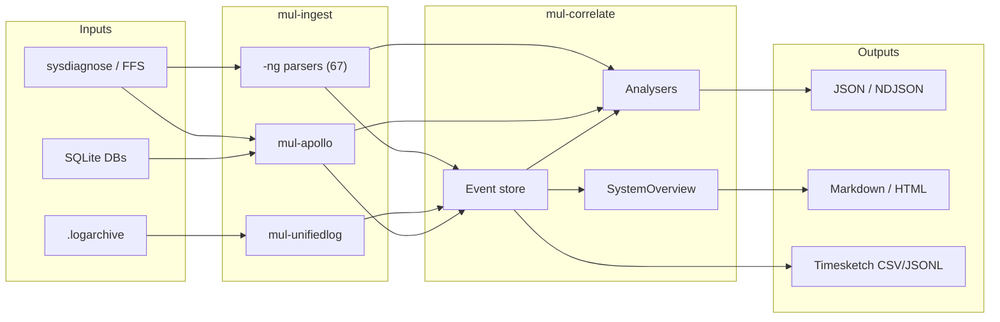
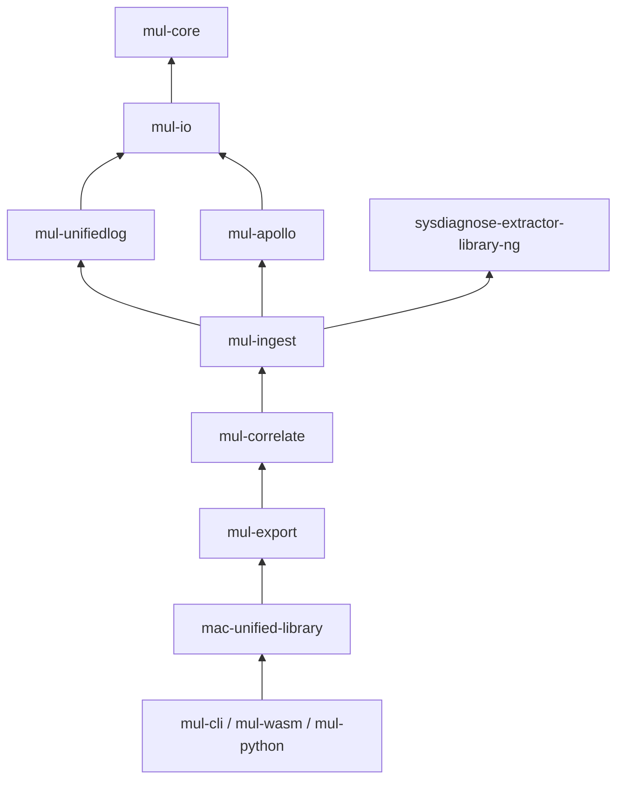
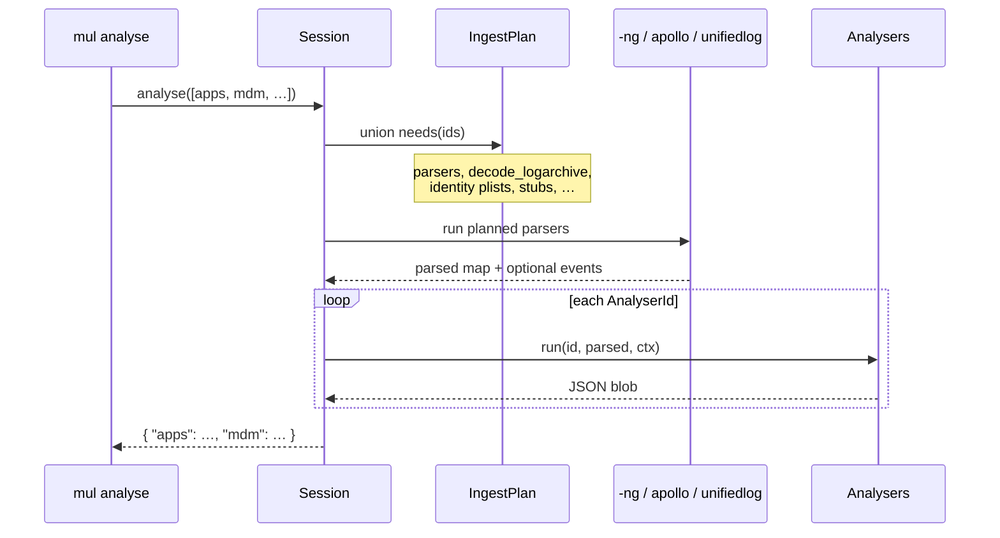
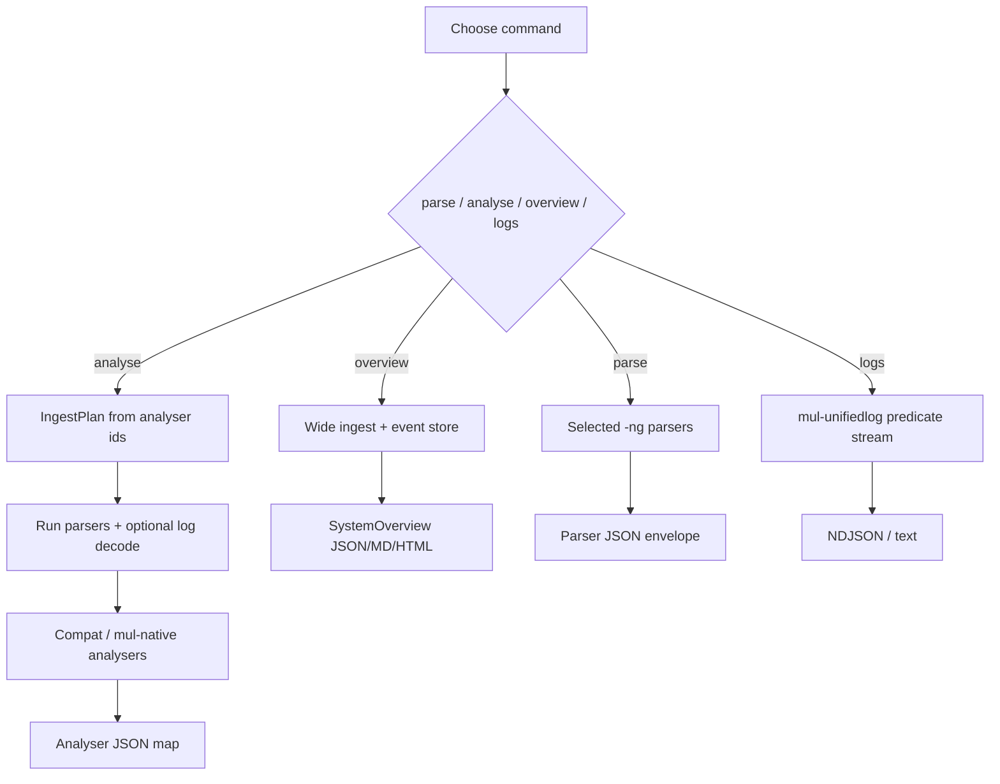

# mac-unified-library

Rust workspace for Apple Unified Logs, APOLLO-NG pattern-of-life, sysdiagnose
correlation, and a system overview. See [SPEC.md](SPEC.md).

Build the CLI once, then use the examples below (replace paths with your archive
or `.logarchive`):

```bash
cargo build --release -p mul-cli
export MUL=./target/release/mul
export SD=/path/to/sysdiagnose.tar.gz          # or extracted folder
export LOG=/path/to/system_logs.logarchive
```

Global flags (any subcommand): `--threads N`, `--mem-budget BYTES`,
`--ioc FILE` (repeatable), `--stats`.

---

## Crates

| Crate | Role |
|---|---|
| `mul-core` | Events, interner, filters, `par` shim |
| `mul-io` | Sources, gzip |
| `mul-unifiedlog` | Clean-room Unified Log decoder |
| `mul-apollo` | APOLLO-NG (247 converted TOML modules + SQLite / Biome) |
| `mul-ingest` | Input discovery + [`-ng`](https://github.com/IsMyPhonePwned/sysdiagnose-extractor-library-ng) adapters |
| `mul-correlate` | Entities, analysers, overview |
| `mul-export` | NDJSON / Markdown / JSON / HTML |
| `mac-unified-library` | `Session` facade |
| `mul-cli` | `mul` binary |
| `mul-wasm` | wasm-bindgen |
| `mul-python` | Python module `mac_unified` |

### How the pieces fit



Dependency direction (no cycles):



### Analyse pipeline

When you run `mul analyse` (or `mul.analyse`), the session builds a **per-analyser ingest plan**, runs only the needed parsers, then each analyser reads that JSON (and optionally the event store).



Typical paths:

| Command | What runs | Heavy bits |
|---|---|---|
| `mul parse --parser X` | One/more `-ng` parsers, tight retention | Usually light |
| `mul analyse --analyser apps` | Plan for `apps` only (TCC, MI, powerlogs, …) | Powerlog SQLite |
| `mul analyse` (no ids) | All **compat** analysers | Union of their plans |
| `mul overview` | Broad ingest + `SystemOverview` | Logs + APOLLO + biome as planned |
| `mul logs` | `mul-unifiedlog` only | Trace decode |



---

## CLI features

### Inventory (`info`)

Lightweight archive / logarchive summary (paths, coverage hints; no full decode).

```bash
$MUL info "$SD"
$MUL info "$LOG" --stats
```

### Unified logs (`logs`)

Decode a `.logarchive` (or sysdiagnose that contains one) with optional predicate.

```bash
$MUL logs "$LOG" --predicate "subsystem == 'com.apple.runningboard'" --limit 20
$MUL logs "$LOG" --format ndjson -o logs.ndjson
$MUL logs "$LOG" --unordered --signposts --limit 100
```

### Parsers (`parse` / `list-parsers`)

Run one or more `-ng` parsers with **tight retention** (no biome / full log ingest).

```bash
$MUL list-parsers
$MUL parse "$SD" --parser powerlogs --stats -o powerlogs.json
$MUL parse "$SD" --parser ps --parser wifi -o light.json
$MUL parse "$SD" --all -o all_parsers.json
# Decode unified-log events inside the logarchive parser (larger / slower):
$MUL parse "$SD" --parser logarchive --decode-logarchive -o logarchive.json
```

### Analysers (`analyse`)

Compat analysers (same ids as upstream sdx) plus mul-native ones. Repeat
`--analyser` or omit it to run all **compat** ids.

```bash
# Installed / observed apps (powerlogs App Info + MI / TCC / …)
$MUL analyse "$SD" --analyser apps -o apps.json

# Processes (ps everywhere)
$MUL analyse "$SD" --analyser processes -o processes.json

# TCC permissions (auth_value → allowed, service labels, sensitive flags)
$MUL analyse "$SD" --analyser permissions -o permissions.json

# Sideload / IPA correlation (optional custom rules)
$MUL analyse "$SD" --analyser install_enrichment \
  --install-rules rules/install_enrichment.toml -o install.json

# Network IOCs (enables unified-log decode in the ingest plan)
$MUL analyse "$SD" --analyser network_iocs -o network_iocs.json

# Device / security summary, Wi‑Fi geo, Timesketch-oriented rows, …
$MUL analyse "$SD" --analyser summary -o summary.json
$MUL analyse "$SD" --analyser accounts --analyser wifi_geolocation
$MUL analyse "$SD" --analyser timesketch -o timesketch_rows.json

# Several at once
$MUL analyse "$SD" \
  --analyser apps --analyser permissions --analyser processes \
  -o bundle.json
```

Full id lists and one-line summaries: [Parsers & analysers](#parsers--analysers).

### System overview (`overview`)

Device / boots / apps / processes / network / security / coverage JSON (or HTML / Markdown).

```bash
$MUL overview "$SD" --format json -o overview.json
$MUL overview "$SD" --format html -o overview.html
$MUL overview "$SD" --format md -o overview.md
```

Schema notes: [docs/OVERVIEW_SCHEMA.md](docs/OVERVIEW_SCHEMA.md).

### Timeline (`timeline`)

Export correlated events for Timesketch or generic NDJSON/CSV.

```bash
$MUL timeline "$SD" --format timesketch-jsonl -o sketch.jsonl
$MUL timeline "$SD" --format timesketch-csv -o sketch.csv
$MUL timeline "$SD" --format ndjson -o events.ndjson
$MUL timeline "$SD" --format csv -o events.csv
```

### APOLLO modules (`modules` / `apollo`)

```bash
$MUL modules list
$MUL modules show tcc_db
$MUL modules validate                        # all embedded modules
$MUL modules validate --path modules/knowledgec.toml

# Run one module against a DB file on disk
$MUL apollo --module tcc_db --db /path/to/TCC.db
$MUL apollo --module powerlog_app_info --db /path/to/CurrentPowerlog.PLSQL
```

### Biome / SEGB (`biome`)

```bash
$MUL biome "$SD" list
$MUL biome "$SD" dump --stream App.InFocus --limit 20
```

---

## Parsers & analysers

Parsers come from the `-ng` input layer (`mul list-parsers` / `mul.parse`).
Analysers live in `mul-correlate` (`mul analyse` / `mul.analyse`).

### Parsers (67)

| Id | Summary |
|---|---|
| `accessibility_tcc` | Accessibility TCC.db privacy grants |
| `apollo_all` | Run all bundled APOLLO modules on discovered SQLite DBs |
| `appinstallation` | App Store / appinstallation SQLite (updates, appstored) |
| `avconference_callsettings` | AVConference CallSettings calldump files |
| `awd_baseband` | Inventory of AWD metriclog / baseband binary traces |
| `battery_bdc` | BatteryBDC CSV power/thermal samples |
| `bluetooth` | Bluetooth / AWDL / companion-link status text |
| `brctl` | CloudDocs `brctl` container list + dump |
| `ckks_pcs` | CloudKit Key Sync + Protected Cloud Storage status |
| `collection_meta` | taskSummary / errors / summaries / sysdiagnose.log meta |
| `containermanager` | MobileContainerManager (`containermanagerd`) logs |
| `crashlogs` | CrashReporter / crashes_and_spins `.ips` |
| `disks` | `disks.txt` (`df`-style volume listing) |
| `interactionc` | interactionC.db (APOLLO) — calls / interactions |
| `ioacpiplane` | IORegistry `IOACPIPlane.txt` |
| `iodevicetree` | IORegistry `IODeviceTree.txt` |
| `iofirewire` | IORegistry `IOFireWire.txt` |
| `ioport` | IORegistry `IOPort.txt` |
| `iopower` | IORegistry `IOPower.txt` |
| `ioservice` | IORegistry `IOService.txt` |
| `iousb` | IORegistry `IOUSB.txt` |
| `itunesstore` | iTunes Store downloads SQLite |
| `kbdebug` | `kbdebug.txt` keyboard / input debug log |
| `knowledgec` | knowledgeC.db (APOLLO) — CoreDuet activity |
| `lockdownd` | MobileLockdown (`lockdownd`) logs |
| `logarchive` | `system_logs.logarchive` inventory (+ optional decode) |
| `logdata_statistics` | logdata.statistics `*.jsonl` process/log stats |
| `logdata_statistics_txt` | logdata.statistics `*.txt` process/log stats |
| `lsaw` | LaunchServices `lsaw.csstoredump` string scrape |
| `mcsettingsevents` | MCState Shared `MCSettingsEvents.plist` |
| `mcstate_shared_profile` | MCState Shared `profile-*.stub` MDM profiles |
| `microstackshots` | microstackshots process-sampling history |
| `mobileactivation` | mobileactivationd activation / lock logs |
| `mobilebackup` | MobileBackup preference plist |
| `mobileinstallation` | MobileInstallation install/uninstall logs |
| `mount` | `mount.txt` (sealed / read-only root integrity) |
| `netusage` | netusage.sqlite (APOLLO) — per-process network use |
| `networkextension` | `com.apple.networkextension.plist` |
| `networkextensioncache` | `com.apple.networkextension.cache.plist` |
| `olddsc` | Old Dynamic Shared Cache (`olddsc`) files |
| `ota_update` | OTA / restore logs under `OTAUpdateLogs` |
| `plists` | Capped decode of archive `*.plist` → JSON |
| `powerlogs` | Powerlog SQLite / APOLLO pattern-of-life |
| `preferences` | Preferences dumps (locale, Screen Time, a11y) |
| `ps` | `ps.txt` process snapshot |
| `psthread` | `ps_thread.txt` process+thread snapshot |
| `quarantine_events` | LaunchServices QuarantineEvents DB (APOLLO) |
| `remotectl_dumpstate` | `remotectl_dumpstate.txt` device / services |
| `runningboard` | RunningBoard state / process assertions |
| `safari_history` | Safari History.db (APOLLO) |
| `screentime` | Screen Time RMAdminStore DBs (APOLLO) |
| `security_sysdiagnose` | `security-sysdiagnose.txt` keychain / Circles |
| `shutdownlogs` | `shutdown.log` last processes before halt |
| `spindumpnosymbols` | `spindump-nosymbols.txt` hang / spin dump |
| `swcutil` | Shared Web Credentials `swcutil_show` |
| `sys` | SystemVersion.plist (OS / build / product) |
| `system_stats` | APFS / VM / SMC / Trial / suggest_tool stats |
| `taskinfo` | `taskinfo.txt` Mach task listing |
| `transparency` | transparency.log as timeline events |
| `transparency_json` | transparency.log as structured JSON |
| `usermanagement` | umtool / usermanagerd accounts & personas |
| `uuid2path` | UUID → binary path map (tailspin) |
| `wifi_diagnostics` | Wi‑Fi ifconfig / arp / netstat / diagnostics text |
| `wifi_known_networks` | Known Wi‑Fi networks plist (SSID / BSS / geo) |
| `wifinetworks` | `com.apple.wifi` preference plists |
| `wifiscan` | Wi‑Fi scan result files |
| `wifisecurity` | Wi‑Fi Security logs |

### Analysers

**Compat** (default when `--analyser` / `analysers=` is omitted):

| Id | Summary |
|---|---|
| `accounts` | Apple IDs / emails from MobileCal, transparency, activation lock |
| `apps` | Installed / observed apps (powerlog App Info, MI, TCC, plists, …) |
| `coverage` | Which parser ids ran vs archive file count |
| `file_stats` | Archive file counts by top-level path / extension / directory |
| `install_enrichment` | Sideload / IPA-style install correlation (TOML rules) |
| `mcstateshared` | MCState Shared profile stub previews |
| `network_iocs` | Heuristic IPv4 / domain / URL / SSID / BSSID hunt (+ logarchive decode) |
| `permissions` | TCC privacy grants rollup (labels, sensitive, `auth_value`) |
| `mdm` | MDM payloads + MCSettingsEvents + Shared_MDM / MDM plist status |
| `processes` | Unified process inventory (`entries`) + per-PID source `matrix` |
| `summary` | Markdown device / lockdown / security / shutdown overview |
| `timesketch` | Plaso/Timesketch-style rows (`csv` / `jsonl` / `events`) |
| `wifi_geolocation` | Known Wi‑Fi BSS coords as **GPX + KML** |

**Mul-native** (pass explicitly):

| Id | Summary |
|---|---|
| `network_extension` | Structured VPN / proxy / DNS / content-filter NE configs |
| `trust_store` | Trust / MITM / pinning / issuer signals from security-sysdiagnose |
| `accessories` | Bluetooth pairings + USB IORegistry accessories |
| `quarantine` | LaunchServices QuarantineEvents download provenance |
| `lockdown_pairing` | MobileLockdown host pairing / trust / session history |
| `crashes` | IPS crash corpus grouped by app/process |
| `runningboard` | RunningBoard domains / assertions / keep-alive grants |
| `account_trust` | CKKS/PCS, Circles/SOS, personas, transparency devices |
| `device_integrity` | Sealed/read-only mounts + OTA / restore hints |
| `overview` | Full `SystemOverview` (device, boots, apps, coverage, …) |
| `app_activity` | Per-day app/source event counts from the store |
| `boots` | Boot UUID windows from ingest |

Rule / indicator matching is deferred to a future **Sigma** analyser (not a separate `anomalies` / `ioc_match` id). Parent/child process links live on `processes` (no `process_tree`).

Aliases (still accepted): `ps_everywhere` / `ps_matrix` / `process_matrix` → `processes`;
`wifi_geolocation_kml` → `wifi_geolocation`; `plist` / `mdm_payloads` → `mdm`.

---

## Python (`mac_unified`)

Requires [maturin](https://www.maturin.rs/). On Python ≥ 3.14 set
`PYO3_USE_ABI3_FORWARD_COMPATIBILITY=1` if the build complains about abi3.

```bash
cd crates/mul-python
maturin develop          # or: maturin develop --release
python -c "import mac_unified as m; print(m.version(), m.module_count())"
```

### API surface

| Function | Purpose |
|---|---|
| `version()` | Library version string |
| `module_count()` / `list_modules()` | APOLLO module registry |
| `list_parsers()` | `-ng` parser ids |
| `list_analysers()` / `list_compat_analysers()` | Analyser ids |
| `info(path)` | Archive inventory dict |
| `overview(path)` | `SystemOverview` as dict |
| `parse(path, parsers=None, decode_logarchive=False)` | Parser envelope (same shape as `mul parse`) |
| `analyse(path, analysers=None, install_rules_toml=None)` | Analyser map; `None` = all compat analysers |
| `apollo_run(module_id, db_path)` | One APOLLO module on a SQLite file |

### Examples

```python
import mac_unified as mul
from pathlib import Path

SD = "/path/to/sysdiagnose.tar.gz"
DB = "/path/to/TCC.db"

print(mul.version(), mul.module_count())
print(mul.list_parsers()[:5])
print(mul.list_compat_analysers())

# Inventory
info = mul.info(SD)
print(info.keys())

# Parsers (tight retention)
pl = mul.parse(SD, parsers=["powerlogs", "ps"])
print(pl["powerlogs"]["ok"], pl["powerlogs"]["duration_ms"])
print(pl["_meta"]["wall_ms"])

# Apps inventory (promoted name/version/executable/sources)
apps = mul.analyse(SD, analysers=["apps"])["apps"]
print(apps["count"], list(apps["apps"])[:5])
for bid, row in list(apps["apps"].items())[:3]:
    print(bid, row.get("name"), row.get("version"), row.get("sources"))

# TCC permissions (labels + sensitive)
perms = mul.analyse(SD, analysers=["permissions"])["permissions"]
print(perms["app_count"], perms.get("sensitive_allowed_grants"))

# Processes
procs = mul.analyse(SD, analysers=["processes"])["processes"]

# Install enrichment with custom rules file
rules = Path("rules/install_enrichment.toml").read_text()
inst = mul.analyse(
    SD,
    analysers=["install_enrichment"],
    install_rules_toml=rules,
)["install_enrichment"]
print(inst.get("rules_source"), inst.get("event_count"))

# Network IOCs (plan enables logarchive decode)
iocs = mul.analyse(SD, analysers=["network_iocs"])["network_iocs"]
print(len(iocs.get("domains", [])), iocs.get("logarchive_decode"))

# Several analysers in one call
bundle = mul.analyse(SD, analysers=["apps", "permissions", "summary"])

# Full compat set
all_compat = mul.analyse(SD)

# System overview
ov = mul.overview(SD)
print(ov["device"], ov["collection"])

# Single APOLLO module on a DB path
tcc = mul.apollo_run("tcc_db", DB)
print(tcc["status"], tcc["rows"])
```

---

## Benchmarks & analyser parity (vs upstream sdx)

```bash
( cd ../sysdiagnose-extractor-library && cargo build --release --bin sdx-cli )
cargo build --release -p mul-cli

# Speed / CPU / RSS for every parser + analyser (sdx vs mul)
./scripts/bench_sysdiagnose.py -i "$SD" --compare-mul \
  --batch-parsers --out benchmarks/results/latest

# JSON shape / key-field parity for compat analysers
./scripts/parity_analysers.py -i "$SD" --out benchmarks/results/parity
```

`mul parse` / `mul analyse` use tight retention / per-analyser plans (no
unified-log ingest unless the plan requests it, e.g. `network_iocs`). See
[docs/BENCHMARKS.md](docs/BENCHMARKS.md) and [docs/NG_INTEGRATION.md](docs/NG_INTEGRATION.md).

### Tests

```bash
cargo test --workspace --exclude mul-python --exclude mul-wasm

# One fixture test per -ng parser / mul analyser (also run by
# .github/workflows/parser-analyser.yml)
cargo test -p mul-ingest --test each_parser
cargo test -p mul-correlate --test each_analyser

# wasm32 build + test compilation (no-run; same job in CI)
cargo build -p mul-core --target wasm32-unknown-unknown --no-default-features
cargo build -p mul-apollo --target wasm32-unknown-unknown --no-default-features --features biome
cargo build -p mul-correlate --target wasm32-unknown-unknown --no-default-features
cargo build -p mac-unified-library --target wasm32-unknown-unknown --no-default-features --features wasm
cargo test -p mul-correlate --target wasm32-unknown-unknown --no-default-features --lib --tests --no-run
```


---

## Licence

GPL-3.0-only. Vendored APOLLO module text retains its original dual-licence headers.
